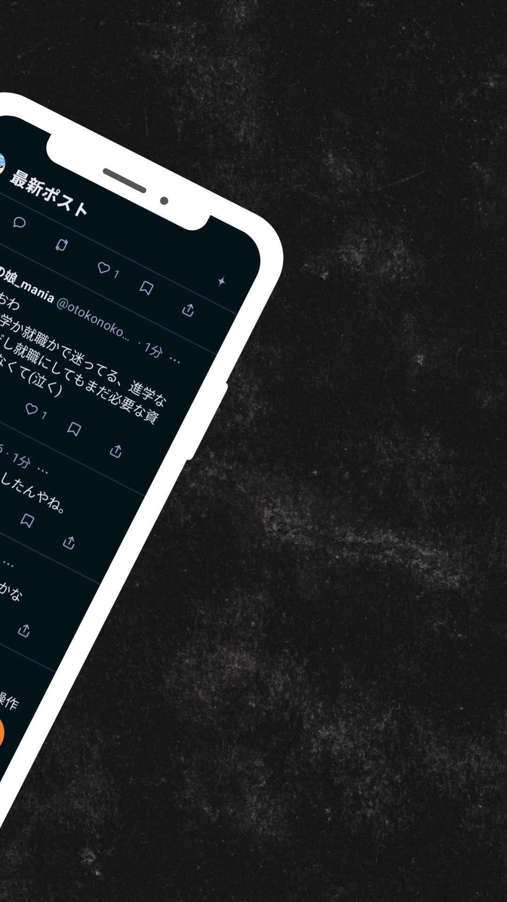
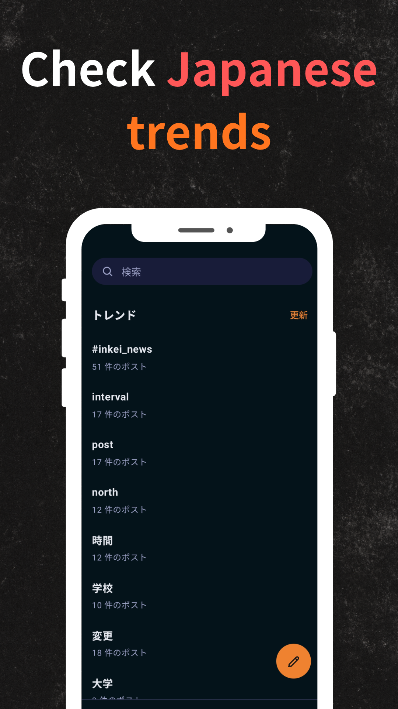
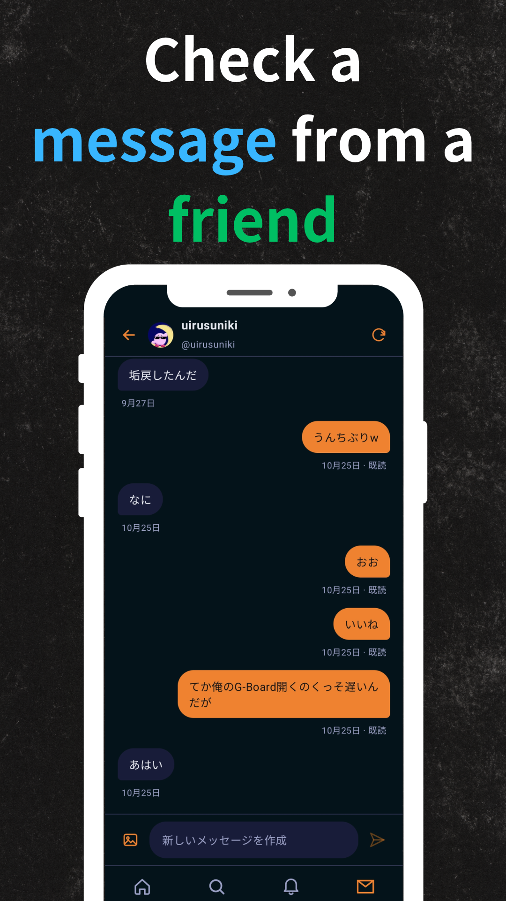
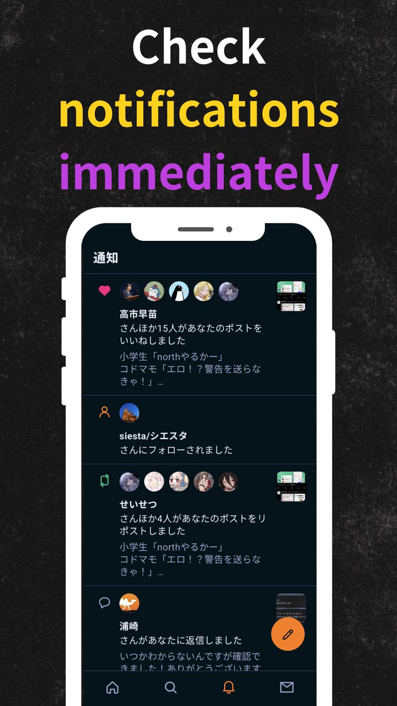

 
 

###### Special Thanks to [North(north.rip)](https://north.rip/)

# north Android

### Unofficial Native Client

 

***

  
  
  
  
  

## 主な機能 (Features)

### 投稿・コンテンツ管理
**投稿の作成・編集・削除**: テキストや画像・動画（メディア）を添付して投稿できます。
 
**下書き機能**: 作成途中の投稿を保存し、後から編集・公開できます。
 
**タイムライン閲覧**: 最新の投稿やトレンド情報をリアルタイムにチェックできます。
 
 

### リアクション・交流
**リアクション・投票**: 投稿へのリアクションや、アンケート（投票）への参加ができます。
 
**フォロー機能**: 気になるユーザーをフォローしてつながることができます。
 
**通知管理**: 自分へのリアクションやフォローなどの通知を確認・管理できます。
 
 

### 整理・カスタマイズ
**ブックマーク**: 後で見返したい投稿を保存・一覧表示できます。
 
**リスト機能**: 特定のユーザーをまとめたオリジナルリストを作成・閲覧できます。
 
**プロフィール編集**: 自身のユーザー情報の確認やプロフィールの更新ができます。
 
 

### セーフティ・管理機能
**モデレーション**: ミュートやブロックなど、快適なタイムラインを保つための管理機能を備えています。
 
 
